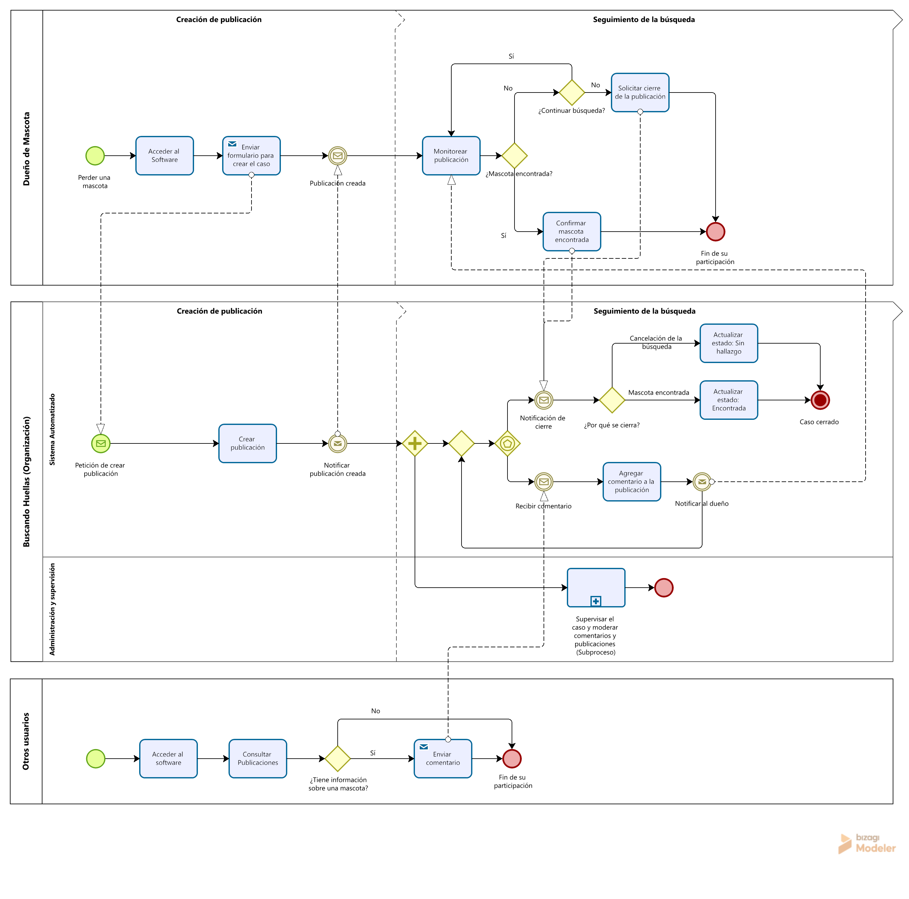
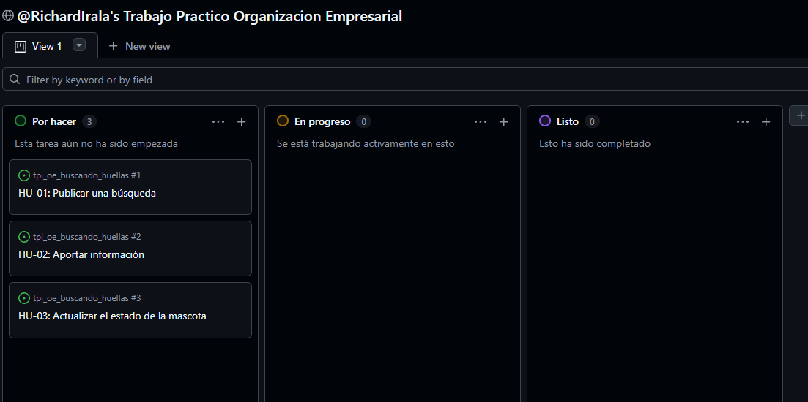

# Buscando Huellas - Documentación Técnica

**Organización Empresarial, TPI Entrega N°4**

**Institución: Universidad Tecnológica Nacional (UTN)**

**Carrera:** Tecnicatura Universitaria en Programación a Distancia

**Estado del proyecto:** propuesta y documentación académica; no implica que el software esté implementado.

**Integrantes:** Richard Miguel Irala

## Descripción

Buscando Huellas es una organización ficticia sin fines de lucro dedicada a facilitar la búsqueda y recuperación de mascotas perdidas mediante la participación de la comunidad.

El proyecto propone el desarrollo de un software que centralice publicaciones de búsqueda, datos de las mascotas, ubicación donde fueron vistas por última vez y comentarios aportados por otros usuarios. Asimismo, contempla la supervisión de los casos y la moderación de contenido por parte de los responsables de la organización.

## Objetivo

Facilitar la localización y recuperación de mascotas perdidas, promoviendo la colaboración de la comunidad mediante un software que permita centralizar la información, difundir los casos y realizar un seguimiento organizado de las búsquedas.

## Participantes del proceso

* Dueño de mascota: registra la búsqueda, consulta novedades y confirma el hallazgo o solicita el cierre.
* Otros usuarios: consultan publicaciones y aportan comentarios con información relevante para la búsqueda.
* Sistema automatizado: publica los casos, registra aportes (comentarios), notifica y actualiza el estado del caso.
* Administración y supervisión: monitorea el caso y modera publicaciones y comentarios mientras la búsqueda está activa.

## Diagrama BPMN del proceso organizativo que el software va a automatizar

El siguiente diagrama representa el proceso organizativo de búsqueda de mascotas perdidas de Buscando Huellas y cómo el software propuesto se integra a él para automatizar determinadas actividades. El modelado se centra en la participación de los distintos actores, las actividades, las decisiones y los posibles caminos de la búsqueda hasta su finalización, sin profundizar en los detalles técnicos del funcionamiento interno del software.

### Archivo BPMN

[Consultar archivo BPMN editable](./docs/diagrama_bpmn.bpm)

## Historias de usuario

El seguimiento de las historias de usuario y las actividades del proyecto se realiza mediante Github Projects, utilizando los estados **Por hacer**, **En progreso**, y **Listo**.

[Acceder al tablero](https://github.com/users/RichardIrala/projects/3/views/1)

## Indicadores de control y estándares de desempeño

Se establecieron indicadores para evaluar el cumplimiento de los objetivos y el funcionamiento esperado del software.

[Consultar indicadores de control](./docs/indicadores_de_control.md)

## Flujo de trabajo con Git

- La rama `main` se utiliza para mantener la documentación principal del proyecto.
- Los cambios se realizan en ramas secundarias, utilizando nombres descriptivos, como `docs/diagrama-bpmn`.
- La documentación complementaria se organiza en el directorio `docs/`.
- Los cambios se integran a `main` mediante Pull Requests, con revisión de pares.
- Los mensajes de commit describen de forma breve y clara las modificaciones realizadas.

## Declaración de uso de IA

Como herramienta de apoyo, se utilizó inteligencia artificial como ChatGPT y Gemini para organizar y desarrollar ideas, detectar posibles errores o inconsistencias en los planteos y realizar revisiones de redacción y estructura así como para revisar la coherencia del modelado BPMN con los contenidos de la Unidad 5 y los trabajos prácticos anteriores.

La elaboración del diagrama BPMN implicó un trabajo manual de análisis, diseño y corrección. Las decisiones sobre los participantes, las actividades, los eventos, las compuertas y los caminos del proceso fueron tomadas a partir de la comprensión del funcionamiento de la organización ficticia Buscando Huellas y de los conocimientos adquiridos durante la materia.

Las consultas realizadas a los asistentes se centraron especialmente en cómo representar correctamente el proceso organizacional que el software acompaña y automatiza. Se buscó evitar que el diagrama se limitara a describir operaciones técnicas del sistema, como crear, editar o eliminar registros en lugar de representar el proceso de búsqueda de mascotas perdidas.

El uso de la IA fue crítico y selectivo. Durante las consultas con Gemini se identificaron respuestas que no representaban adecuadamente las indicaciones, por lo que varias de sus propuestas o correcciones fueron descartadas. Posteriormente se utilizó principalmente ChatGPT para resolver dudas específicas sobre la notación BPMN y consolidar el trabajo previamente desarrollado.

Las respuestas de los asistentes no se consideraron automáticamente correctas. A lo largo del desarrollo del trabajo, se consultó el material teórico impreso de la materia para validar las decisiones tomadas y fundamentar las modificaciones realizadas.

Asimismo, ChatGPT se utilizó como apoyo para estructurar la documentación del repositorio y mejorar la redacción.

[Consultar el registro detallado de prompts y correcciones](./docs/prompts_ia_detallado.md)